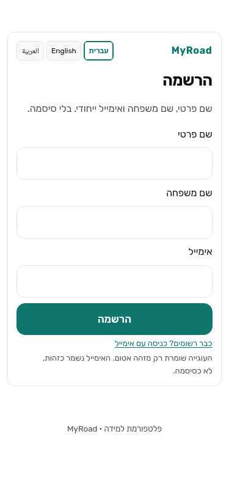
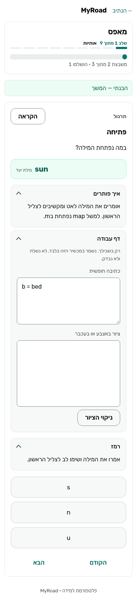
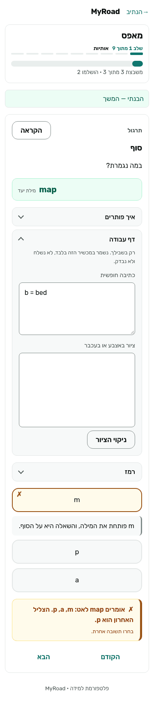
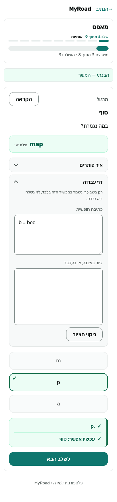
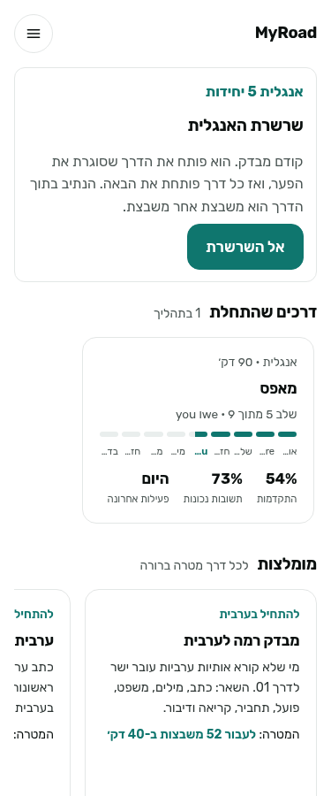
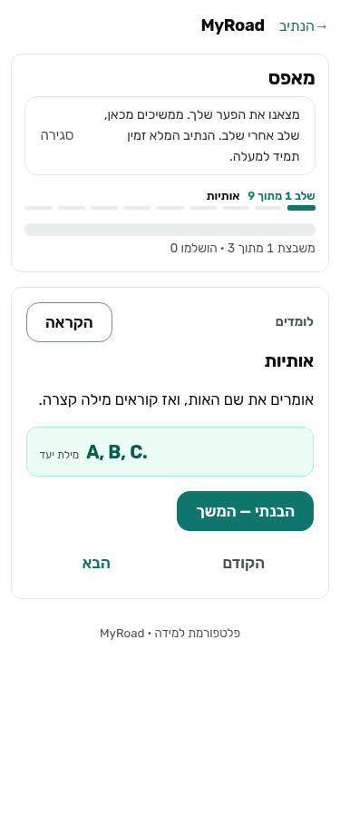
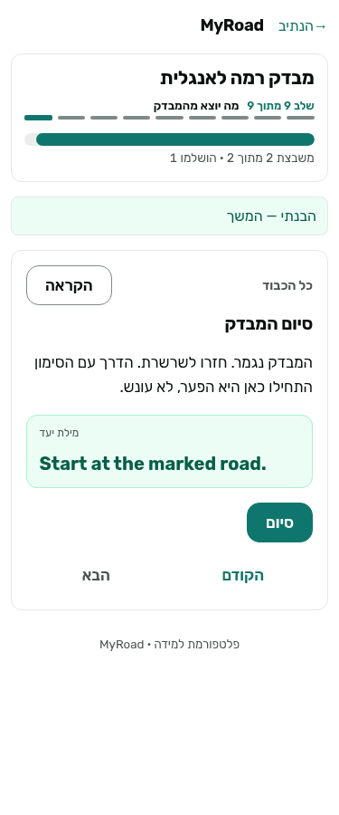
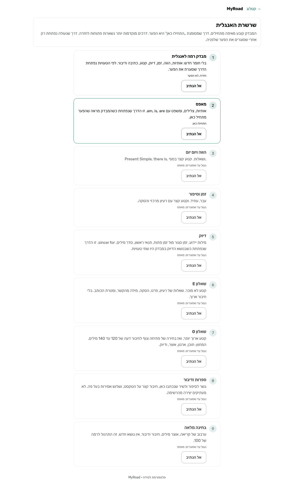
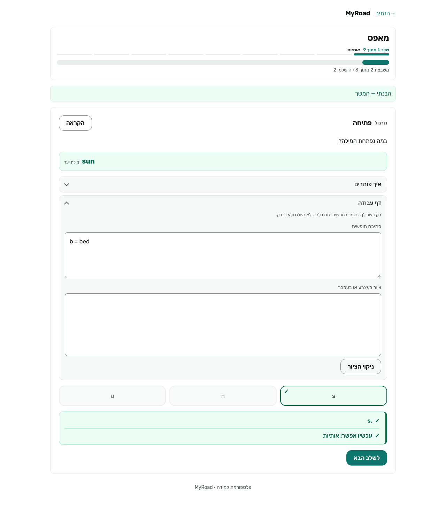

# סיור קבלה: לומד אנגלית בוגר, דובר עברית

תאריך: 2026-11-02. בעלים: MyRoad PM. בסיס: `main` בקומיט `cbf76f2` (כולל #195, ראש הנתיב מ-#193).
איך: שכפול נקי, תוכן מ-`Eliot100/MyRoad-content`, `uvicorn myroad_core.ui.app:app`, Playwright headless, ממשק בעברית, רוחב 375 ו-1280. כתובת בדיקה זמנית (`walk375@example.test`), קוד כניסה מקונסולת הפיתוח (`MYROAD_DEV_MAIL_CONSOLE=1`, מתועד ב-`packages/core/README.md`).
מסלול: הרשמה, קוד, בית, שרשרת האנגלית, מבדק רמה (27 משבצות), תוצאה, דרך "מאפס" (13 משבצות). אפס שגיאות קונסול בשני הרוחבות.

## מה עובד

- **הרשמה וכניסה בקוד** עוברות בלי תקלה, RTL תקין. 
- **רמז** (`details` מתקפל) ו**"איך פותרים"** (worked method, #189/#190) מופיעים בכל משבצת תרגול, בעברית קצרה וברורה. 
- **משוב לכל בחירה** (#187/#188): תשובה שגויה מסומנת ✗ ומסבירה למה ("אומרים map לאט: m, a, p"), ואפשר לנסות שוב. 
- **דף עבודה** (#183/#186): טקסט וציור, נשמר במכשיר בלבד.
- **רגע סיום משבצת**: ✓ ושורת "עכשיו אפשר: ..." וכפתור "לשלב הבא" (#191, קריטריון ראשון). 
- **ראש הנתיב** (#195): שם הדרך, "שלב X מתוך 9", מסילת שלבים ופס התקדמות; אחרי המבדק מוצגת שורה "מצאנו את הפער שלך...". בבית מופיע כרטיס "דרכים שהתחלת" עם 54%, 73% נכונות, "היום". 
- משבצות דיבור ("אמרו", הקלטה אופציונלית) לא חוסמות את מי שאין לו מיקרופון.

## שלושת הפערים, לפי השפעה על הלומד

### 1. המבדק מוריד לומד חזק ל"מאפס" (בעלים: bot:dev)
לומד שענה נכון על 16 מתוך 21 שאלות, כולל קטע קריאה, הסקה ומילה מהקשר, נשלח לדרך 01 "מאפס" ("אותיות, A, B, C"). הסיבה ב-`placement_band` (`content/english_bagrut.py`): הסף הוא `incorrectTaps >= 4`, ו-`incorrectTaps` סופר **כל הקשה שגויה**, כולל ניסיון שני באותה שאלה. חמש הקשות שגויות בארבע שאלות = רמה 1.
ראיה: `GET /api/placement/result` -> `{"band":1,"correct":16,"incorrect":5,...}`. בנוסף, ברשימת "הדרכים שלי" המבדק מסומן "לתרגול" ב-100%.
השפעה: בוגר שיודע לקרוא קטע מקבל "A is a letter". זה מעליב, משעמם, והסיכוי לנטישה ביום הראשון גבוה.

### 2. אין רגע תוצאה למבדק (בעלים: bot:ui)
אחרי 27 משבצות, המשבצת האחרונה אומרת "המבדק נגמר. חזרו לשרשרת" ו"סיום" מעביר ישר למשבצת הראשונה של הדרך המומלצת. אין מסך שאומר מה עשיתי טוב, באיזו רמה אני, למה הדרך הזו, וכמה זמן היא. ה-API כבר מחזיר `band`, `correct`, `recommended_road_id`. רגע התוצאה הוא התגמול הגדול הראשון בנתיב, ועכשיו הוא חסר.
 

### 3. הודעה "הבנתי — המשך" נתקעת מעל כל משבצת (בעלים: bot:ui)
אחרי הקשה ראשונה על "הבנתי — המשך" מופיע פס ירוק `flash ok` עם אותו טקסט, והוא נשאר מעל כרטיס המשבצת ב-38 מתוך 40 המשבצות שנבדקו, גם אחרי תשובה נכונה ו"לשלב הבא". הוא נראה כמו משוב אבל לא אומר כלום, דוחף את השאלה למטה ב-375, ומחליש את רגע ה-✓ האמיתי.

## הערות קטנות (לא הוגשו)
- שם תחנה מעורב "you וwe" מוצג משובש ב-RTL בראש הנתיב (375-13-path-head).
- משוב נכון קצר מאוד ("נכון. s.").
- אין רגע סיום תחנה (אחרי 3/3 באותיות עוברים ישר לתחנה הבאה). נרשם כתגובה ב-#191.

## רשומת החלטה
- **הקשר:** סיור קבלה אחד, לכל היותר 3 issues, דירוג לפי השפעה על הלומד, מעורבות כעדיפות (אליוט, 2026-11-02).
- **חלופות:** (א) סיור אמיתי בדפדפן עם צילומים (נבחר); (ב) קריאת קוד ובדיקות בלבד: זול, אבל לא היה מגלה את פער 1 ו-3; (ג) סיור ידני בלי סקריפט: לא ניתן לשחזור.
- **החלטה:** (א). הסקריפט מנסה את האפשרויות לפי הסדר עד הנכונה, כמו לומד שמנחש. זה מחמיר את פער 1, אבל לומד אמיתי עם 4 טעויות קטנות יגיע לאותה תוצאה.
- **נבדק:** 27 משבצות מבדק + 13 משבצות דרך, שני רוחבות, 0 שגיאות קונסול, תשובת ה-API מתועדת.
- **מגבלות:** לא נבדקו וריאנטים בלי שמע/כתיבה, לא ar/en, לא מכשיר אמיתי.
- **מעבר לחלופה:** להריץ שוב את `drive.py` (בתיאור ה-PR) על main חדש.
